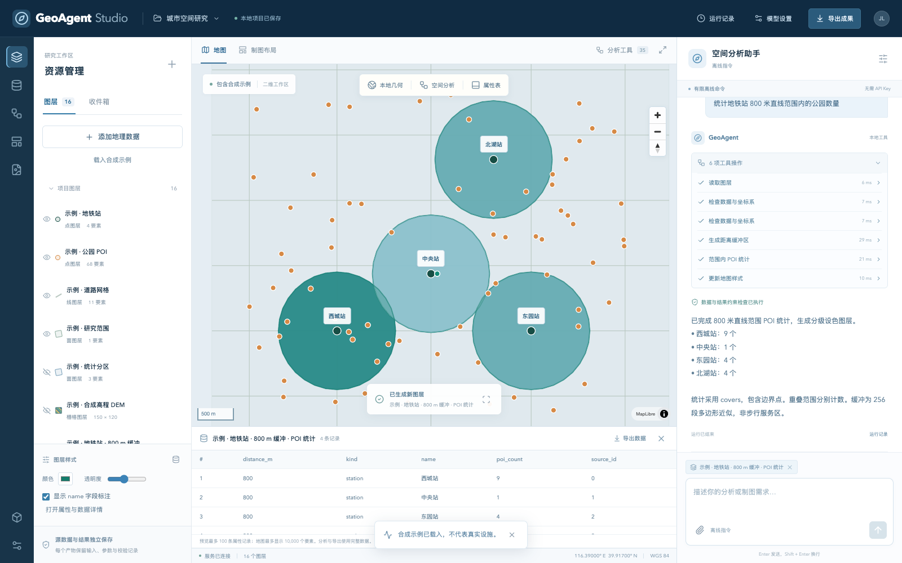

# GeoAgent Studio · v0.2

自然语言驱动的本地 GIS 工作台：导入矢量与栅格、执行空间分析、把结果发布为新图层，并按语言要求制作地图。



这是可运行的第二版验收实现。目标是逐步覆盖桌面 GIS 工作流；**目前还不等同于 QGIS / ArcGIS 全量能力，也没有经过与其他 Agent 的同条件性能评测。**

## 启动

需要 Python 3.12、Node.js 22，以及支持 WebGL 的浏览器。

```bash
python3.12 -m venv .venv
.venv/bin/python -m pip install -r backend/requirements.lock.txt
cd frontend
npm ci --ignore-scripts
npm run build
cd ..
./start.sh
```

打开 [本地工作台](http://127.0.0.1:8765)。已有依赖可直接运行 `./start.sh`。
应用只监听本机回环地址；工作区默认保存在 `.geoagent/`，不进入 Git。
可通过 `GEOAGENT_WORKSPACE` 指定独立工作区，通过 `PORT` 修改端口。
Linux 中文制图需要安装 Noto CJK 字体；macOS 自动使用 Arial Unicode。

## 可以验收什么

- **数据收件箱**：附件上传、多文件配套、ZIP / KMZ 解包、资源与子图层发现、自然语言导入、缺失 CRS 提示。
- **35 个确定性算法**：缓冲、裁剪、叠加、空间连接、最近邻、筛选、字段计算、网格、DBSCAN、IDW、热力密度、栅格计算、NDVI、地形分析、栅格转面、分区统计等。
- **结果自动入层**：每次分析保存新数据；原输入保留。支持空结果、属性表、样式、重命名、定位、数据导出和处理血缘。
- **真实制图输出**：PNG / JPEG / TIFF / SVG / PDF；A4 / A3、横竖版、标题、指北针、图例、比例尺与角落位置。预览和导出共用布局。
- **Responses API**：工具调用后原样回传 reasoning / function-call 项，保留加密推理上下文；可选择推理强度。兼容 Chat Completions。
- **可重放工作流**：模型可保存算法 DAG；执行时校验参数、检查输入、逐节点发布结果并保留执行凭据。

完整目录和限制见 [能力与格式](docs/CAPABILITIES.md)，操作步骤见 [验收说明](docs/ACCEPTANCE.md)。

## 数据与自然语言

点击“添加地理数据”，或把附件交给右侧助手。Shapefile 同时上传 `.shp/.shx/.dbf/.prj` 或使用 ZIP；GeoPackage 可选择子图层；带地理参考的 TIFF 可直接入层。

```text
请检查并导入刚上传的 stations.zip
统计地铁站 800 米直线范围内的公园数量
计算 DEM 的坡度，把结果加入图层，再统计各分区的平均坡度
把指北针放到左上角，图例放到右下角，标题设为“研究区分析”，导出 PDF
将这套缓冲和统计步骤保存成工作流，下次用相同参数重放
```

复杂语义规划需要连接模型；**离线模式是有限规则解析**，支持明确的示例缓冲 / 计数、导入、布局调整和导出，不具备通用推理。算法工具箱和已保存工作流无需模型即可运行。
模型遇到多个输入、子图层或缺少坐标系时，应先询问，不自行猜测。

## 模型设置

在“模型设置”中选择“连接模型”，填写实际可用的模型名与 API Key。
OpenAI 根地址为 `https://api.openai.com/v1`，协议选“自动”或“Responses”。自动模式为官方 OpenAI 地址选择 Responses，其他兼容地址默认选择 Chat Completions；支持 Responses 的代理可手动指定。

密钥只保存在当前页面内存；刷新后需重新填写。也可在启动前设置 `GIS_LLM_API_KEY`。密钥不写入浏览器存储、运行记录或 Git。
模型接收任务、图层摘要、属性样本与工具结果；完整地理文件留在本地。“测试连接”会发起一次短请求，可能产生 API 用量，不读取地理文件。

Responses 使用 `store: false` 和 `reasoning.encrypted_content`，在单次任务的工具循环中保留加密推理项；不展示或落盘隐藏思维链。界面展示任务计划、实际工具步骤、参数、结果和用量。
当前不是逐 token 流式显示；不同聊天轮次使用历史任务与结果文本，重启不恢复推理状态。
真实供应商请求需要使用自己的有效凭据验收，模拟响应不能代替真实连通性。

## Harness 与实现

React + MapLibre / FastAPI + GeoPandas + GDAL + Rasterio + Shapely + PyProj + Matplotlib。

```text
自然语言任务 / 手动算法 / 工作流
             ↓
模型适配 → 计划与工具发现 → 参数契约与输入检查
             ↓
确定性 GIS 执行 → 结果检查 → 独立数据与图层
             ↓
SQLite 事件 / 输入哈希 / 方法参数 / 布局与下载成果
```

- `provider.py`：Responses / 兼容协议、连接诊断、密钥脱敏。
- `harness.py` / `studio_tools.py`：类型化工具、检查钩子、模型循环、计划与失败反馈。
- `algorithms.py`：35 个算法与参数契约；表达式使用受限 AST，不执行任意 Python。
- `formats.py`：GDAL 导入导出、收件箱、栅格预览、原生投影快照。
- `workflows.py`：最多 12 节点的依赖检查、拓扑执行和重放凭据。
- `cartography.py`：统一布局与五种真实格式的渲染。
- `store.py`：SQLite 追加事件、不可变产物与 SHA-256 血缘。

模型循环最多 24 轮，轮间检查 600 秒预算，HTTP 超时独立为 120 秒。Responses 每轮最多 12 个调用，兼容 Chat 每轮最多 8 个；Responses 同一失败调用连续重复 3 次后停止。
工作区一次运行一个任务。“停止”在当前工具 / HTTP 返回后生效，已完成图层保留；重启将未完成任务标记中断，不宣称自动断点续算。

## 验证

```bash
.venv/bin/python -m pytest -q
cd frontend && npm run build
```

浏览器检查应使用隔离工作区，避免操作真实项目：

```bash
GEOAGENT_WORKSPACE=/tmp/geoagent-qa PORT=8766 ./start.sh
# 另一终端，提供 Playwright 和浏览器后执行
BASE_URL=http://127.0.0.1:8766 node scripts/browser-test.cjs
```

可用 `PLAYWRIGHT_MODULE` 指定模块、`CHROME_PATH` 指定 Chrome。实际验证结果见 [verification.json](verification.json)。
`sample-data/` 和界面示例均为合成数据，不代表真实站点、公园、行政区或地形。

## 下一阶段与限制

QGIS Processing 引擎桥接、路网服务区、更多符号和布局模板、大文件分块 / 空间数据库、检查点恢复、澄清后继续、跨项目工作流和独立 GIS 正确性基准尚待实现。
本版没有多用户鉴权、三维、Earth Engine、影像深度学习、自动在线数据检索、拓扑编辑、删除 / 撤销和完整桌面工程互通。
地图导出采用 EPSG:3857 和当前可见数据，不含在线底图；地图 TIFF 是排版图像，栅格数据导出才是地理参考 GeoTIFF。

参考依据和取舍见 [架构参考](docs/RESEARCH.md)。界面按 Anthropic 官方 `frontend-design` 技能指导重新实现，未复制其他 GIS Agent 的源码或截图。
