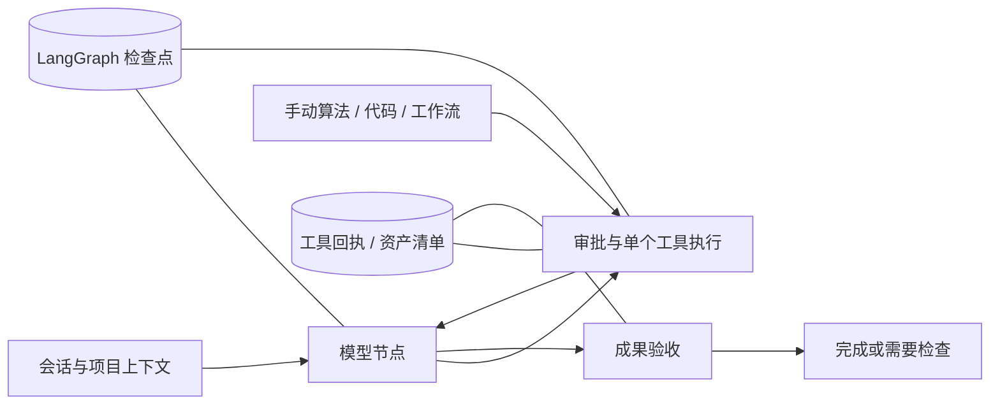

# GAIA v0.4：持久执行、审批、记忆与工具沉淀

保留 v0.3 的 Web 工作台和插件 SDK。新增 LangGraph 1.2.19、SQLite checkpointer 3.1.3，复用框架的节点调度、持久检查点、interrupt / Command 恢复和有限重试；GIS 输入、产物、权限与验收仍由 GAIA 管理。

## 执行与恢复



- `session_id` 表示会话，`run_id` 对应一次任务和一个 LangGraph thread。浏览器刷新沿用会话，可切换/新建会话。旧记录按原 session ID 迁入会话列表。
- 模型节点和每次外层工具调用之间保存同步检查点。Responses 的 reasoning、function-call、function-call-output 原样保留，不暴露隐藏思维文本。
- `workspace.sqlite3/tool_steps` 记录稳定步骤 ID、参数签名、输入哈希、尝试次数、状态、结果与校验；工作流使用稳定节点回执。重放已完成步骤时校验输入、输出哈希后复用结果。
- 进程退出后任务标为 interrupted；助手提供“从检查点继续”，通过 `POST /api/runs/{id}/resume` 使用同一任务 ID 恢复。已完成工作不会作为新任务整体重跑。
- 如果进程在外部文件写出与结果回执提交之间退出，无法证明该步骤是否完成。此时暂停并要求审核，不能承诺任意第三方插件的严格 exactly-once，也不会盲目重跑。
- 已运行到一半的单个 GDAL/QGIS 进程没有像元级恢复能力。恢复边界是模型节点、工具和工作流节点；输入或产物发生变化会阻止复用。
- 模型轮次上限 24，单次恢复执行有 600 秒预算；429/502/503/504 最多重试 3 次。同参数工具失败达到 3 次停止循环。
- 任务使用进程内互斥和工作区文件锁，避免多个服务同时执行同一工作区的任务。默认仍建议一个服务进程。
- v0.3 历史任务没有执行检查点，保留查看和导出，但不能伪造恢复。

## 审批与秘密

普通读取与受限 GIS 操作默认运行。模型生成的代码、长期偏好修改、插件启停、工具推广、第三方算法以及较大输入触发具体操作审批；代码自动执行偏好可由用户明确开启。手动代码/算法参数表中的“运行”本身已经是授权。

审批绑定任务、步骤、参数和输入哈希；允许/拒绝保存在本地，等待可以跨重启。Skills 不扩展执行权限。经验证且人工推广的代码工具可按原契约复用，较大输入仍可能触发审批。

API Key 不进入 SQLite、检查点或浏览器持久存储。等待/失败任务可在当前服务内暂存密钥；重启后使用服务端 `GIS_LLM_API_KEY` 或页面重新提供密钥继续。模型与协议沿用任务原设置，避免更换模型后错误重放推理项。

检查点文件权限为 0600；其中包含本地会话、工具结果和服务商协议状态。Responses 可包含不透明加密推理项；DeepSeek Chat 可返回可读的 `reasoning_content`，为继续工具调用而保存在本地检查点，不在界面或运行日志中展示。检查点文件本身并非整体加密。LangSmith tracing 在任务执行范围内明确关闭，不自动上传跟踪记录。

DeepSeek 跨任务使用既有问答摘要作为资料上下文，不把缺少原生推理字段的摘要伪装成服务商助手消息。当前任务内实际返回的推理字段随工具结果原样回传；旧版本未保存的协议状态无法凭空恢复。

## 结果验收

`validation.py` 统一检查文件存在性、非空导出、文件哈希、图层数量、几何有效性、CRS，以及声明的字段、数量范围、几何类型和导出格式。

`set_acceptance` 可声明任务验收；API 提交的验收条件优先，模型不能降低。图层条件应用于本次最后发布的目标图层，中间图层仍做基础检查。缺少必要成果、未解决的工具失败、文件缺失等会得到 `needs_attention`，不能仅靠模型说“完成”变成 completed。空结果会提示核对范围。

这不等于通用科研正确性证明或自动视觉评审。特定方法仍需要独立的数值、拓扑或领域检查；出图视觉质量仍需审阅。代码配方验证可加入数值指标上下界。

## 五层记忆

| 层 | 实现与边界 |
|---|---|
| 工作上下文 | 同会话最近问答、当前任务、图层摘要、选择图层、地图范围、偏好、知识命中；本次模型与工具链由检查点保存。暂不提供 QGIS 桌面选中要素桥接。 |
| 执行状态 | LangGraph SQLite、任务事件、工具回执、计划状态、审批、输入和产物哈希。 |
| 项目资产 | 原生地理文件与结构化目录；访问目录/组装上下文时检测文件哈希，刷新物理元数据，按血缘递归使派生成果、关联知识和配方验证失效。不是后台文件监视器；外部改写后的源数据须重新导入，防止原生数据与 Web 副本混用。 |
| 稳定偏好 | CRS、距离/面积单位、语言、风格、输出格式、数据目录提示、代码权限、图件规范；有显式设置与清除入口。数据目录偏好不授予任意文件访问权限。聊天不会自动变成长记忆。 |
| 方法知识 | SQLite FTS5 trigram 检索，支持中文方法、SOP、来源、审核标记与依赖图层；提供添加、搜索、遗忘。Skills 单独保留按需加载。此版没有接入 embedding 服务，也不把几何或分析结果变成向量权威存储。 |

## 自增长工具库

`draft → verified → promoted`：

1. 自定义代码运行后可以保存配方，此时只是草稿。
2. 在目录的“自定义算法 → 验证与推广”中设置验收 JSON，再次执行代码，保存代码哈希、输入哈希、运行时信息、产物和校验结果。
3. 用户审阅代码、数值条件和成果，确认后推广。未验证、验证失败、代码或验证数据变化均不能推广。
4. 下一次 Agent 运行注册 `recipe_<id>` 类型化工具，输入别名成为必需参数；重用时继续执行原验收条件。

示例验收：

```json
{"layer":{"min_count":1,"fields":["area_km2"],"crs":"EPSG:32610"},"metrics":{"features":{"min":1,"max":10000}}}
```

模型不能自行绕过审核推广。工具不会自动安装依赖或获得额外系统权限。这个阶段提供受控沉淀，不宣称自动发明、证明和审核任意研究算法。

## 验收入口

- 右侧助手顶部：会话选择、新建会话、书本图标“项目与记忆”。
- 任务消息中：具体操作审批、从检查点继续、成果验收状态。
- 目录 → 自定义算法：验证与推广。

参考：[LangGraph interrupts](https://docs.langchain.com/oss/python/langgraph/interrupts)、[LangGraph persistence](https://docs.langchain.com/oss/python/langgraph/persistence)。
