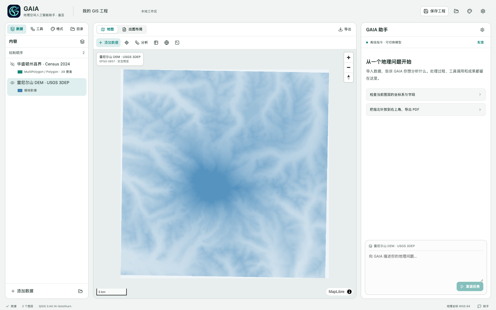

# GAIA 用户手册

**GAIA — Geospatial Artificial Intelligence Assistant · 地理空间人工智能助手盖亚**

适用版本：桌面预览版 **0.5.0-beta.4** 及对应工作台。更新日期：2026-11-03。

GAIA 把数据、地图、分析工具和自然语言助手放在同一工作区。你可以填写参数直接运行算法，也可以让助手检查数据、编排多步分析并生成地图。成果以独立数据和文件保存，方便复核与继续使用。

**各平台可下载的安装包以当前 Release 实际文件为准。** 本手册不把规划中的能力当作已交付功能。各版本状态见 [桌面版交付状态](DESKTOP_STATUS.md)。

[下载安装包](https://github.com/liujiayuGIS/gaia/releases) · [桌面源码](https://github.com/liujiayuGIS/gaia/tree/codex/desktop-beta2) · [安装与构建说明](DESKTOP.md)

## 目录

1. [安装与第一次启动](#install)
2. [十分钟完成第一张地图](#quickstart)
3. [认识工作区](#workspace)
4. [连接模型与设置推理](#model)
5. [导入矢量、栅格和表格](#import)
6. [管理图层与绘制顺序](#layers)
7. [用自然语言安排分析](#agent)
8. [手动运行算法](#algorithms)
9. [声明数据含义与核验成果](#quality)
10. [编辑布局与专业出图](#cartography)
11. [保存、导出与分享成果](#export)
12. [会话、审批与任务恢复](#recovery)
13. [项目记忆与方法知识](#memory)
14. [插件、Skills、代码与工作流](#extensions)
15. [可直接改写的任务示例](#examples)
16. [备份、更新与数据隐私](#data)
17. [常见问题](#faq)
18. [能力边界与问题反馈](#limits)

<a id="install"></a>
## 1. 安装与第一次启动

### 选择安装包

| 你的设备 | 安装包 | 当前状态 |
| --- | --- | --- |
| M 系列 Mac | `GAIA-0.5.0-beta.4-mac-arm64.dmg` | macOS 15 或更新；以 Release 实际文件为准 |
| Windows 10/11 x64 | `GAIA-0.5.0-beta.4-win-x64.exe` | 原生构建与安装验收后发布，以 Release 实际文件为准 |

在 Mac 的“关于本机”查看芯片或处理器。仓库已公开，安装包可直接下载，无需登录 GitHub。公开访问不授予仓库写权限。

1. 从 [Releases](https://github.com/liujiayuGIS/gaia/releases) 下载对应 DMG。
2. 打开 DMG，把 GAIA 拖入“应用程序”。
3. 从“应用程序”启动 GAIA，等待本地 GIS 环境校验、解压和初始化。
4. 出现地图工作台后即可导入数据。无需另装 Python、Node.js 或 QGIS。

首次启动可能需要几分钟，并需要数 GB 可用空间。解压期间保持应用打开；如果初始化失败，保留日志后点击“重试”。日后启动会复用准备好的运行环境。

当前测试版尚无 Apple Developer ID 与公证，系统可能提示未知开发者。确认来源和 SHA-256 后，可使用系统对单个应用提供的允许打开入口；不要关闭系统整体安全保护。发布页附带校验文件，例如在下载目录执行：

```bash
shasum -a 256 -c GAIA-0.5.0-beta.4-mac-arm64.dmg.sha256
```

Windows 用户使用对应的 `.exe.sha256` 文件核对。只有校验成功再继续使用。

<a id="quickstart"></a>
## 2. 十分钟完成第一张地图

这条流程不需要 API Key，使用合成演示数据学习操作。示例站点、公园和地形不是真实调查数据，不能用于研究结论。

1. 在空白地图点击 **加载演示数据**。已存在图层时，可直接使用自己的点数据，按第 8 节手动运行缓冲。
2. 在助手设置中选择 **离线指令**，应用设置。
3. 在右侧助手输入并发送：

   ```text
   统计地铁站 800 米直线范围内的公园数量
   ```

4. 等待任务结束。图层列表应增加缓冲区和计数结果，原输入图层仍保留。展开工具步骤和“检查依据与覆盖范围”，查看实际执行与提示。
5. 选中计数结果，点击地图工具栏的 **属性表**，查看统计字段。属性表只预览前 200 条；完整结果需导出数据。
6. 打开 **出图布局**。在布局设置中把标题改为“站点周边公园分布”，选择 A4 横向，填写“合成演示数据，仅用于功能演示”的来源说明。
7. 点击指北针或图例，在页面上拖动位置；点击 **检查出图 → 检查当前布局**，根据提示调整。
8. 点击 **导出**，选择 PDF 与 150 DPI，点击 **导出并下载**，在系统保存对话框选择位置。

完成后应有：原始图层、两层分析成果、可查看的运行记录，以及一个实际 PDF 文件。这里的 800 米是直线距离，**不是步行 800 米或步行服务区**。

<a id="workspace"></a>
## 3. 认识工作区



上图用于识别主要区域；最新版本增加了会话、记忆和质量检查入口，按钮以当前安装版本为准。

| 区域 / 入口 | 用途 |
| --- | --- |
| 左侧“数据” | 选择图层、显隐、定位、删除与恢复、调整绘制顺序 |
| “工具”或地图上方“分析” | 检索算法、选择输入、填写参数、预检查与运行 |
| “格式” | 修改当前图层符号、名称、数据含义与时间，导出数据 |
| “目录” | 工程、布局模板、成果文件、数据收件箱、插件、Skills、自定义算法、工作流 |
| 中央“地图” | 平移缩放、查看要素、切换底图、打开属性表 |
| 中央“出图布局” | 按纸张尺寸编辑地图与装饰元素 |
| 右侧“GAIA 助手” | 连续对话、执行计划、工具结果、审批、恢复任务 |
| 顶部“保存工程” | 保存当前 QGIS 工程及数据包 |
| 顶部“外观设置” | 浅色 / 深色、强调色、地图背景色 |
| 桌面菜单“文件 / 帮助” | 打开工作区、查看日志、获取更新 |

桌面宽窗口中，拖动地图与助手之间的细分隔线可以调宽 / 调窄助手；调整后自动保留。聚焦分隔线后用左右方向键微调，Home / End 到达边界；双击或 Enter 恢复默认，拖动中按 Esc 取消。出图模式会为版式工具与地图保留空间，窄窗口沿用独立页面导航。

界面主题只影响工作台外观，打印纸张保持白色。名称旁的眼睛按钮决定图层是否显示；“选中图层”与“可见图层”是两个不同状态。

<a id="model"></a>
## 4. 连接模型与设置推理

### 两种使用方式

| 方式 | 适合做什么 | 是否需要模型 API |
| --- | --- | --- |
| 手动算法、布局操作、已保存工作流 | 已知输入和参数的分析、编辑与出图 | 不需要 |
| 离线指令 | 列图层、明确的示例缓冲 / 计数、有限导入与布局命令 | 不需要 |
| 连接模型 | 理解复杂要求、选择工具、多步骤编排、生成代码、视觉审图 | 需要 |

离线指令是有限规则解析，不能代替大模型。复杂要求在离线模式下没有执行，不代表对应 GIS 算法不存在；可改用参数表，或连接模型。

### 配置 OpenAI

点击右侧助手的 **配置** 或齿轮，选择 **连接模型**：

| 字段 | 填写方式 |
| --- | --- |
| API 根地址 | `https://api.openai.com/v1` |
| 模型名称 | 你的 API 账号实际可调用、支持工具调用的精确模型 ID |
| 接口协议 | `Responses`；官方 OpenAI 地址选择“自动”也会使用它 |
| 推理强度 | 先用 `medium`；简单任务可试 `low`，复杂任务可试 `high`，具体须受模型支持 |
| 每轮输出预算 | 默认 8192 tokens；可选择 16384 / 32768 等，必须在服务商支持范围内，推理也可能占用预算 |
| API Key | 对应服务商的有效密钥 |
| 允许发送地图预览进行视觉审阅 | 需要视觉审图时开启，并使用支持图像输入的模型 |

点击 **测试连接**，成功后点击 **应用设置**。连接测试会发起一次短模型请求，可能产生 API 用量；它不等于已完成 GIS 分析或证明模型能正确完成任意任务。

根地址不用填写 `/responses` 或 `/chat/completions`，GAIA 会按协议追加端点。第三方代理应填写该代理提供的根地址和模型 ID；“自动”对非官方地址默认使用 Chat Completions，支持 Responses 的代理需手动选择 Responses。

GAIA 在 Responses 工具循环中保留供应商返回的推理项及工具回执，让推理与工具调用连续进行。界面展示计划、操作和结果，不展示隐藏思维文本。协议依据见 [OpenAI 推理模型文档](https://developers.openai.com/api/docs/guides/reasoning)。

如果提示本轮输出触及上限，打开模型设置提高“每轮输出预算”，应用设置后点击原任务的“从检查点继续”。已完成步骤会按输入与产物版本核对后复用；不完整的工具调用不执行。DeepSeek 工具循环保留服务端返回的 `reasoning_content`，界面不展示原始推理内容。这些服务商状态可能是可读文本，为续跑保存在本地检查点；检查点文件本身并非整体加密。跨任务历史以问答摘要作为资料装配。若旧版任务已缺少服务商要求的历史状态，应新建任务，已有图层和成果仍保留。

密钥仅保留在当前页面内存，刷新、退出后需要重填。界面设置可保留，但不保留密钥。增加推理强度不保证分析正确，也可能增加耗时和 API 用量；最终仍要检查输入、方法和成果。

<a id="import"></a>
## 5. 导入矢量、栅格和表格

### 通用导入流程

1. 点击 **添加数据 / 添加地理数据**，或把文件拖入导入窗口。
2. 选择文件。多个配套文件应一起选择。
3. 点击 **直接导入**。若检测到多个资源或子图层，按提示选择后再次导入。
4. 文件缺少坐标系时，根据数据说明填写 EPSG 编码。未知时先查清来源，不要为了导入而随意填写。
5. 导入成功后，核对名称、坐标系、记录数、字段和地图位置。

**交给助手导入**会先把文件放入“数据收件箱”，并把导入请求填入聊天框；请核对后再发送。仅在聊天中输入电脑路径，不能代替上传文件或授予文件访问权限。

```text
请检查并导入刚上传的 roads.zip。
若包含多个资源，先列出各资源与坐标系供我选择。
导入后告诉我几何类型、字段和要素数量。
```

### 按格式准备文件

| 数据 | 建议准备方式 | 容易遇到的问题 |
| --- | --- | --- |
| Shapefile | 同名 `.shp`、`.shx`、`.dbf`、`.prj` 一起上传；有 `.cpg` 也一起提供，或打成 ZIP | 只传 `.shp` 会缺属性或其他配套信息；中文编码依赖原文件 |
| GeoPackage `.gpkg` | 上传单个文件，明确选择所需子图层 | 一个文件可以包含多个图层，不应任意选第一个 |
| GeoJSON | 标准 FeatureCollection，核对坐标值与数据来源 | 经纬度顺序错误、无效几何、把投影坐标误当经纬度 |
| GeoTIFF `.tif/.tiff` | 带 CRS 和有效地理参考的栅格 | 普通图片改后缀不会变成地理数据；还需核对 NoData、波段与单位 |
| CSV 点表 | UTF-8 表头，包含下方支持的坐标列名 | 没有坐标的普通统计表不能直接作为点层；投影坐标需声明 CRS |
| KML / KMZ、GML、FGB、GeoParquet、DXF、GPX、TAB、MIF 等 | 按格式提供配套资源，先用小样本验证 | 受实际 GDAL 驱动、几何和坐标系约束 |
| FileGDB | ZIP 内保留完整 `.gdb` 目录 | 是地理数据库资源入口，不是 ArcGIS 工程导入；尚未逐项验证互通 |

### Shapefile 中文编码与字段名

默认依据 `.cpg` / DBF 代码页读取文字编码。声明缺失或冲突且存在非 ASCII 文本时，系统要求明确实际编码；可在导入窗口选择 UTF-8、GBK、GB18030 等，也可明确要求助手按相应编码导入。请勿仅凭“能解码”判断编码正确，应核对属性表中的真实名称。

中文字段名可能被 Shapefile 的长度限制截断。默认仅对明确识别的多字节尾部截断，在临时副本中生成唯一安全别名，保留源文件、原字段字节和映射，并显示警告；可以取消此修复。缺失的完整原名无法恢复，须核对别名含义。属性值解码失败时拒绝导入，不丢弃或有损替换数据。需要完整字段名时，优先使用 GeoPackage。

CSV 支持 `lon/lat`、`lng/lat`、`longitude/latitude`、`经度/纬度`、`x/y` 列名。下面是可保存为 UTF-8 CSV 的**合成示例**：

```csv
name,lon,lat
示例点A,116.40,39.90
示例点B,116.41,39.91
```

CSV / GeoJSON 当前入口未额外声明时按 EPSG:4326 处理；如果原数据是其他坐标系，必须在导入前明确提供。原文件已经声明 CRS 而填写值与之冲突时，系统会拒绝；应先按原 CRS 导入，再执行“重投影”。**赋予 CRS 不等于转换坐标。**

当前单次上传及 ZIP 解压总量上限 250 MB，ZIP 最多 2000 个成员；矢量单层最多 100,000 要素。更大文件应先在 GIS 工具中裁切或分批准备，详见 [能力与格式](CAPABILITIES.md)。

<a id="layers"></a>
## 6. 管理图层与绘制顺序

点击图层名称选择当前图层。助手输入框会显示当前绑定；任务涉及多个数据时仍应明确写出每个输入名称。

- **显示 / 隐藏**：点击眼睛按钮；隐藏不删除数据。
- **删除 / 恢复**：点击图层行右侧的垃圾桶，从工作区移除图层；源文件与本地恢复数据保留。提示条可点击“撤销删除”。也可告诉助手“删除图层 地铁站”或“恢复图层 地铁站”；名称重复时先明确目标。删除矢量或栅格后，重启不会自动加回。删除图层不等于删除要素或永久销毁数据。
- **定位**：选中图层后点击“缩放至图层”，或使用图层定位交互。
- **排序**：拖动图层左侧手柄；也可选择图层后点上移 / 下移。聚焦手柄后用方向键、Home / End 调整，Esc 取消拖动。
- **符号**：进入“格式”，调整主色、不透明度、分级设色字段及名称标注。
- **改名**：在“图层名称”中编辑，离开输入框后保存。
- **看属性**：选中矢量层，点击属性表。最多预览 200 条；地图预览也可能截断，后台数据量以图层元数据和导出为准。

列表越靠上，显示优先级越高；矢量和栅格共用这套顺序。常见排列为“点标记 → 线 → 半透明分析面 → 栅格”。如果点被面或影像遮住，先检查顺序和不透明度。

结果以新数据和新图层保存，不覆盖原输入。重复分析可能产生多个相近名称，建议加入距离、日期或版本，例如“站点缓冲_800m”。隐藏不需要展示的中间层，再检查最终出图。

<a id="agent"></a>
## 7. 用自然语言安排分析

一个可执行任务通常应说明：**用哪些数据、解决什么问题、采用什么方法和口径、输出什么、如何验收**。

```text
使用“地铁站”和“公园 POI”两个图层，生成每站 800 米直线缓冲。
统计每个缓冲区内的公园点，包含边界；重叠区域按每站分别计数。
保留站点名称，把结果命名为“站点公园覆盖_800m”，加入图层。
检查输入坐标系、距离单位和计数结果，并告诉我未验证的部分。
```

使用真实数据时，把示例名称替换成工作区中的图层名。人口分析还要提供数量含义和单位；路网分析还要提供交通方式、速度或时间成本、方向规则；跨期比较要说明数据日期。

助手会按任务读取图层摘要和相关工具，执行前检查参数，执行后记录成果与质量信息。出现“需要你的确认”时先查看具体操作。任务卡片中的工具记录可以展开，下载“运行记录”保留执行证据。

后续调整可以沿用同一会话，例如“保持同样口径，再做 1200 米并列出差异”。当前没有逐 token 显示，长任务会显示处理状态；不要因暂时没有文字输出而重复发送同一任务。

<a id="algorithms"></a>
## 8. 手动运行算法

手动参数表适合清楚知道方法、希望精确控制参数的情况，也不依赖模型可用性。

1. 点击 **工具** 或 **分析**，输入中文名称、英文名称或算法 ID 检索。
2. 在“全部 / QGIS / Python”切换提供者，选择算法。
3. 查看“帮助”，逐项选择输入数据并填写参数，带 `*` 的参数必须填写。
4. 展开 **分析口径与验收**，说明距离单位、边界口径、重叠区域统计要求等。
5. 填写输出名称，点击 **预检查**。根据提示补充数据说明或重投影。
6. 通过后点击 **运行**。成果将保存到当前工程数据并加入图层。

QGIS 工具的距离参数通常遵循其算法及输入 CRS；经纬度图层中的“800”不应直接当作 800 米。内置 Python 距离工具有自己的局部投影约束。选择“单位为米”只是声明分析要求，**不是替数据执行了重投影**。

常见任务可从缓冲、裁剪、相交、融合、空间连接、面内点计数、面积 / 长度、坡度、山体阴影、栅格计算与分区统计开始。目录由当前插件实际提供；可见目录项不代表每一个算法及其外部依赖都已验收。

<a id="quality"></a>
## 9. 声明数据含义与核验成果

### 先补齐数据语义

选择图层，进入 **格式 → 数据含义与时间**。根据数据文档填写数量含义、单位、日期、来源和确认依据，点击 **保存数据说明**。

| 数据 | 应明确的信息 | 避免的误用 |
| --- | --- | --- |
| 人口栅格 | 每像元人数，还是人口密度；`people`、`people/km2` 等 | 直接把人口密度像元求和当人数 |
| DEM | 高程单位，例如 `m`；水平 CRS 与单位 | 把经纬度水平坐标或英尺高程直接当米 |
| 分类栅格 | 像元是类别编码 | 用不适合类别值的连续插值重采样 |
| 多期数据 | 各自日期、时间口径 | 无说明地混用不同年份作同年结论 |

未知字段留空，先向数据提供方确认。来源和依据是声明证据，系统不会因此独立证明原始数据真实准确。语义与文件版本绑定，数据变化后需要重新核对。

### 看懂检查结果

任务卡片的 **检查依据与覆盖范围**区分错误、警告和“尚未验证”。当前有针对面叠加、点计数、部分点缓冲、逐像元栅格和受约束最短路径的独立核验；适用前提和预算有限，并非所有算法都具备专用领域核验器。

| 验收模式 | 含义 |
| --- | --- |
| 标准 | 展示已做的检查、警告和未覆盖项，供你判断 |
| 严格 | 要求适用规则完整覆盖；缺少专用规则、仅抽样或超预算时不能视为严格通过 |

“需要检查成果”表示结果未达到当前验收要求。即使地图已出现，也应先阅读报告。严格验收不是“更聪明的模型”，也不能补足缺失的路网、数据时间或人口口径。

人口密度积分的面积权重、复杂路网吸附与转向限制等仍需专门方法；相关限制详见 [空间质量说明](https://github.com/liujiayuGIS/gaia/blob/codex/desktop-beta2/docs/SPATIAL_QUALITY.md)。

<a id="cartography"></a>
## 10. 编辑布局与专业出图

### 建立页面

进入 **出图布局 → 布局设置**，优先选择 **QGIS 原生布局**或“自动（优先 QGIS）”。设置纸张 A4 / A3、横竖方向、通用地图 / 分级设色 / 地形模板、主图层和地图投影。填写标题、副标题、来源说明，按需开启图例、指北针、比例尺与经纬网。

交互地图中的 EPSG:3857 提示不等于所有分析与打印都使用该投影。专业出图应根据研究区和目的选择合适的地图 CRS；不要照抄其他地区示例的 UTM 分区。

### 手动调整元素

| 操作 | 方法 |
| --- | --- |
| 移动 | 选中元素，在纸面上拖动 |
| 改大小 | 拖动边缘 / 角上的控制点；按住 Shift 可约束比例 |
| 精确定位 | 在“格式化元素”填写 X、Y、宽度、高度（mm）和旋转角度 |
| 多选 / 对齐 | Shift 选择多个元素，再使用左对齐、居中或右对齐 |
| 调整地图中心和比例 | 选择地图框，修改其“地图范围”四个坐标值，注意对应 CRS |
| 改文字 | 选择文本元素，在元素属性中编辑文本、字号和颜色 |
| 加元素 | “插入元素”选择文本、地图框、图例、比例尺、指北针、矩形或图片 |
| 避免误拖 | 勾选“锁定位置”；隐藏元素可在内容列表重新显示 |
| 撤销 / 重做 | 工具栏按钮；布局画布获得焦点时可使用快捷键 |

布局画布获得焦点后，方向键移动选中且未锁定的元素 1 mm，Shift + 方向键移动 5 mm；Delete / Backspace 隐藏选中元素。文字输入框获得焦点时，这些键用于文字编辑。

自然语言也能调整布局，例如：

```text
保留当前可见图层。标题设为“研究区公共服务设施”，使用 A4 横向。
将指北针放到右上角，图例放在地图右侧留白，保留比例尺。
来源说明写为“数据：我提供的设施清单；分析口径：800 米直线距离”。
先生成预览并检查版面，指出需要我确认的地方。
```

### 选择样式与字体（当前开发版）

在 **出图布局** 的元素列表选择指北针、比例尺、图例或标题，即可在左侧“格式化元素”里改样式；选择纸面上的元素也会打开同一面板。

| 元素 | 当前可选项 |
| --- | --- |
| 指北针 | 经典箭头、双色三角、罗盘玫瑰、极简线形，以及颜色；方向关联主地图真北 |
| 比例尺 | 单线框、双线框、中线 / 上方 / 下方刻度、阶梯线、空心分段、数字比例；以本机 QGIS 实际目录为准；可改米 / 千米、分段数、字体、字号、字重、颜色 |
| 高程与地形 | 在“页面”设置或图例属性中选择经典地形、柔和绿棕、蓝绿、Viridis、灰度色带；可反转颜色、开关山体阴影与等高线、设等高距及图例小数位 |
| 文字 / 图例 | 从本机与随附字体目录选择；可逐元素设置字号、字重和颜色，文字支持斜体，图例支持列数 |
| 全图默认字体 | 左侧“页面 → 地图字体”；自动模式优先选择本机中文字体，例如 macOS 的苹方、Windows 的微软雅黑或 Linux 上的 Noto / 思源字体 |
| 界面字体 | 顶部“外观设置 → 界面字体”，可选系统现代、中文黑体或中文宋体，保存在当前浏览器，与地图字体独立 |

这些高级选项使用 QGIS 原生渲染。预览、PDF / SVG / 位图导出、QGIS 工程和布局模板读取同一套设置。高程色带只改变打印地图的表现，不改变 DEM 像元值；切换比例尺单位保留实际地面距离。

**自然语言示例**（已打开米制 DEM 的地形布局时）：

```text
指北针改成罗盘玫瑰，比例尺用双线框，单位米，分4段，高程改成蓝绿色带。
标题用苹方，字号24，加粗。
```

离线模式支持上面这些明确的样式名称、位置、字体和导出指令；不会把未知样式报告成修改成功。字体必须在可用目录中，Windows 可将“苹方”换成实际目录中的字体。安装包随附 Noto Sans CJK SC 常规与粗体，在离屏环境中也可使用；不会把字体安装进系统。自由描述、复杂的组合排版和自定义元素需要连接模型；助手可先读取 `get_layout_styles` 及 `get_layout`，再通过 `update_layout_element` 合并修改一个元素，保留其他元素和已拖动的位置。

更改造型、字体后等待页面更新，再检查实际导出的文件。新增指北针目前提供四款内置造型；普通图片仍可通过图片元素上传。尚未完整开放 QGIS 所有排版属性，也没有自动安装缺失字体。

### 检查与美化

点击 **检查出图 → 检查当前布局**，查看真实地图预览及程序检查。重点核对文字截断、版面溢出、图例是否涵盖实际图层、比例尺与指北针关联、元素遮挡和标注冲突。

**应用出版版式**可调整说明字号和图例位置，是排版起点。应用后应重新检查，不能保证所有内容自动达到出版标准。支持图像的模型还可以通过 **交给 GAIA 视觉审阅**查看地图；该操作会发送地图预览，需开启模型设置中的图片权限。

程序检查与模型观察分别记录。屏幕预览和 120 DPI 审图不能替代最终文件在实际印刷尺寸下的复核。正文层级、颜色含义和空间事实仍需你判断；建议先减少无关中间图层，再调整标注密度和留白。

<a id="export"></a>
## 11. 保存、导出与分享成果

| 你要保存什么 | 入口 | 结果 |
| --- | --- | --- |
| 分析数据 | 选择图层 → 格式 → 导出数据 | 矢量界面可选 GPKG、SHP ZIP、GeoJSON、FGB、CSV、KML；栅格为 GeoTIFF |
| 排版地图 | 出图布局 → 导出 | PDF、SVG、PNG、JPEG、TIFF；100 / 150 / 200 / 300 DPI |
| QGIS 工程 | 顶部“保存工程”或目录 → 工程 | 保存本地工程，可下载 QGZ 与工程和数据 ZIP |
| 布局模板 | 布局工具栏“保存布局模板”或目录 → 布局模板 | 保存后应用，或下载 QPT |
| 执行与质量记录 | 任务卡片“运行记录”“下载核验记录” | 可复核的 JSON 记录 |
| 已导出文件 | 目录 → 成果文件 | 再次下载已生成文件 |

在桌面版点击下载后，使用系统保存对话框选择位置。导出文件同时保留在本地工作区的成果目录中；关闭对话框不应被理解为已保存到你指定的外部文件夹。

**地图 TIFF 是排版图片；图层数据导出的 GeoTIFF 才是带地理参考的栅格数据。** CSV 导出是属性表，不包含几何。Shapefile 字段名受格式限制，较长字段优先使用 GPKG。

PDF / SVG 中的矢量元素可保留矢量，栅格以影像嵌入；当前打印导出不包含交互地图的在线底图。用于报告可选 PDF，演示插图可选 PNG，继续分析应导出地理数据。

跨电脑分享 QGIS 工程优先下载 **工程与数据 ZIP**，解压后保留相对路径。单独 QGZ 不包含完整外部数据；接收方需要兼容的 QGIS 环境。QGIS 工程包也不是完整 GAIA 备份，不包含全部聊天、任务检查点和个人设置。

当前“目录 → 工程 / 布局模板 → 打开 / 应用”面向 GAIA 已保存条目；任意外部 QGZ/QPT 的完整导入和桌面 GIS 工程无损互通尚未实现。

<a id="recovery"></a>
## 12. 会话、审批与任务恢复

### 连续会话

右侧助手顶部可选择会话，点击 `+` 新建。沿用同一会话适合追问和修改方法；新会话用于另一段讨论。**新会话不会创建独立工程或清空当前图层**，这些会话共享本地工作区。

### 审批

出现 **需要你的确认**时，展开“查看操作、输入与代码”，检查任务将使用的数据、参数和代码，再选择 **允许本次操作**或 **拒绝**。审批只针对该具体步骤，不是永久授权。

模型生成代码、长期偏好修改、部分插件操作和较大输入等可能触发审批。手动参数表中的“运行”已表达你对该次参数的授权。安装 Skill 不会绕过审批或扩大文件权限。

### 中断后继续

1. 重开 GAIA，进入原会话，找到中断任务。
2. 模型任务先在设置中重新填写 API Key；恢复沿用任务原来的模型与协议。
3. 若卡片提供 **从检查点继续**，点击后等待系统核对输入和已有成果版本。
4. 有审批或未能确认完成状态的步骤，按提示先审核。

恢复边界是模型节点、工具调用和工作流节点。已完成且输入 / 输出版本一致的步骤可以复用；正在执行到一半的单个 QGIS / GDAL 运算不能从中间像元续算。旧版本没有检查点的任务也无法追溯恢复。

若提示输入或成果已变化，不要编辑 SQLite 或强行绕过检查。核对文件并重新导入正确版本，再决定新建任务。任务运行时可点击 **停止任务**，停止可能要等当前调用返回；已完成成果保留。

<a id="memory"></a>
## 13. 项目记忆与方法知识

点击助手标题旁的书本图标 **项目与记忆**。

- **长期偏好**：明确保存常用 CRS、语言、距离 / 面积单位、制图风格、图件规范与代码自动执行偏好。点击“清除偏好”可重置。
- **项目资产**：查看图层摘要和版本状态。显示“已失效”时先检查数据变化，不能继续依赖旧验证。
- **方法与知识**：添加团队 SOP、制图规范、参考方法及来源；可检索或“忘记这条知识”。

记忆分工如下：当前对话和地图提供工作上下文；检查点保存执行状态；地理文件和资产目录保存数据事实；偏好保存你明确设置的习惯；知识库检索方法说明。当前知识检索使用全文索引，没有把几何或栅格结果交给 embedding 作为权威存储。

聊天中的每句话不会自动成为长期偏好。知识条目也不会自动证明某种方法正确；仍应填写来源，并在具体数据上核验。忘记知识或清除偏好不会删除分析文件和历史任务。

<a id="extensions"></a>
## 14. 插件、Skills、代码与工作流

### 执行插件

打开 **目录 → 执行插件**，查看 QGIS / Python 是否可用、版本、算法数量与错误信息。只有插件可用且启用后，相关能力才能执行。该页面用于管理现有插件；不是从任意网址一键安装 GIS 应用的商店。

QGIS 提供 Processing、原生布局和工程能力；Python 提供内置算法与 GeoPandas / Rasterio 等代码环境。出现依赖缺失时按具体错误处理，不因目录中存在算法名称就假定依赖齐全。

### 安装 Skill

在 **目录 → Skills → 安装 Skill**选择 Markdown 或包含 `SKILL.md` 的 ZIP。Skill 描述方法步骤，插件负责执行；Skill 本身不安装依赖、不授予任意网络或系统文件权限。

最小文件示例（保存为 `SKILL.md`，前后 `---` 不可省略）：

```markdown
---
name: project-map-review
description: 按项目要求检查地图来源、图例、比例尺与版面。
version: "1.0"
---
先检查图层和数据说明，缺失来源时询问用户。
完成出图后运行地图检查，列出错误、警告和未验证项。
需要视觉审阅时使用真实预览，不凭文字假设地图没有遮挡。
```

安装后可在目录查看流程，任务中明确要求“按 project-map-review 检查地图”。加载流程不等于已经执行，仍以工具记录为准。

### 写代码完成特殊分析

点击地图工具栏 **Python 分析**，选择 Python 或 PyQGIS 环境，绑定输入数据 `data`，编写代码后运行。Python 的 `inputs['data']` 对矢量是 GeoDataFrame，对栅格是 Rasterio 数据集；PyQGIS 输入则是 QgsMapLayer，接口不能混用。

下面示例适用于 **Python 环境 + 一个矢量输入**，复制数据并增加几何类型字段：

```python
result = inputs['data'].copy()
result['geom_type'] = result.geometry.geom_type
destination = output_dir / 'geometry_types.gpkg'
result.to_file(destination, driver='GPKG')
outputs = {'带几何类型的图层': str(destination)}
metrics = {'feature_count': len(result)}
```

输出必须写到 `output_dir` 并通过 `outputs` 声明，真实文件才会成为成果。运行器限制文件、时间和网络访问，不能在分析代码中随意安装依赖或读写电脑上的任意目录。

填写“保存为自定义算法”后可保留配方。到 **目录 → 自定义算法 → 验证与推广**，设置验收条件并运行验证；检查代码、指标与实际成果后勾选审核确认，才可 **推广到工具库**。保存草稿不等于已经验证或能被自动复用。

### 保存与重放工作流

连接模型后可要求“将这套缓冲和统计步骤保存成工作流”。在 **目录 → 工作流**找到记录并运行，重放时不要求再次由模型规划。

当前工作流最多 12 个节点，绑定当前项目的图层与参数。跨项目输入替换、执行中任意改计划及通用图形流程编辑尚未提供；需要换输入时先核对绑定，不能把旧流程直接当作通用模板。

<a id="examples"></a>
## 15. 可直接改写的任务示例

以下复杂任务需连接模型，并事先导入名称一致的数据。它们是任务表达范例，不保证在缺少输入、依赖或必要口径时能够执行。

### DEM 坡度与分区统计

```text
使用“研究区 DEM”和“统计分区”。先核对 CRS、范围、NoData 和高程单位。
高程单位依据已保存的数据说明；若缺失，请先问我。
在适合研究区的米制投影下计算坡度，再统计各分区的有效像元数和平均坡度。
结果分别加入新图层，指出单位、边界处理和未覆盖的核验项。
```

### 人口栅格：先确认口径

```text
我想统计“服务范围”内的人口。请先读取“人口栅格”的数量含义、单位和日期。
若是密度，不能直接求和；先说明所需的面积权重和边界处理方法。
缺少必要说明时暂停计算。完成后给出数据、方法与核验范围。
```

### 路网任务：先检查能否分析

```text
使用“步行路网”，检查它是否适合做 15 分钟步行可达性分析。
请核对连通性、交叉口打断、方向、速度字段和时间成本单位，列出缺失信息。
在确认路网条件前，不要把直线缓冲当作步行服务区。
```

### 制图与复核

```text
把“分区平均坡度”制作成 A4 横向地图，标题写“研究区坡度概况”。
使用适合连续数值的分级配色，图例放右侧，指北针放左上角，保留比例尺。
来源说明使用当前数据已确认的信息，不要编造年份。
检查标注、图例和版面后导出 PDF 与 300 DPI PNG，并给我核验记录。
```

<a id="data"></a>
## 16. 备份、更新与数据隐私

### 数据在哪里

| 内容 | 保存位置 / 方式 |
| --- | --- |
| macOS 工作区 | `~/Library/Application Support/GAIA/workspace` |
| Windows 工作区 | `%APPDATA%\GAIA\workspace` |
| 会话、检查点、成果、知识 | 工作区中的数据库及文件 |
| 界面主题、模型非密钥设置 | 桌面用户数据中的界面存储 |
| 页面填写的 API Key | 仅当前页面内存 |
| 启动日志 | 桌面菜单“帮助 → 打开日志目录” |

完整备份时先退出 GAIA，再复制整个 GAIA 用户数据目录到安全位置；至少保留完整 `workspace`。不要只复制一个 SQLite 文件，可能遗漏地理文件、检查点或数据库辅助文件。工作区备份不包含只保存在内存的 API Key。

只搬迁分析项目时可使用数据导出或 QGIS 工程 ZIP。跨机器复制完整桌面用户数据尚未提供一键迁移验证，运行环境也不能跨 OS / 架构直接复制使用。现有浏览器开发版工作区不会被桌面版自动迁移或覆盖。

### 更新与清理

从 Releases 下载新版本，退出 GAIA 后替换应用。当前采用手动更新，尚无后台自动更新。工作区与程序分开保存；重要任务更新前仍建议备份。

运行时按哈希保存，旧版本环境目前不自动清理，可能占用较多空间。先确认新版本能正常使用并备份工作区，再处理旧文件；不要在运行中删除当前环境或工作区。

### 什么会发送给模型

连接模型后，会发送任务文字、图层摘要、部分属性样本和工具结果；开启视觉审阅时还会发送地图 PNG 预览。完整原始地理文件保存在本机，但这不代表发给模型的摘要、样本或截图没有敏感信息。

离线算法不需要模型 API。在线底图仍需要网络。运行记录和知识库可能包含项目内容，分享日志、工程或截图前请检查个人信息和密钥；不要把 API Key 粘贴进聊天或代码。

<a id="faq"></a>
## 17. 常见问题

| 现象 | 先检查什么 / 如何处理 |
| --- | --- |
| GitHub 下载显示 404 | 使用当前 `liujiayuGIS/gaia` 发布页，核对版本与文件名；仓库已公开，无需登录 |
| 首次启动停留在准备环境 | 等待当前解压；确认磁盘空间。失败时从“帮助”打开日志，保留报错再重试，不删除工作区 |
| macOS 提示未知开发者 | 当前测试版没有 Apple 公证；核对来源与校验值，只使用系统对单个可信应用的允许入口 |
| `Failed to fetch` | 分清是本地服务还是模型连接：查看启动日志，确认工作台能读图层，再在模型设置测试连接 |
| 模型 HTTP 401 / 403 | 检查密钥、账号权限与服务商地址是否对应 |
| 模型 HTTP 404 | 核对精确模型 ID、根地址及协议；根地址不要重复追加端点 |
| HTTP 400，提到 `reasoning_effort` 或工具调用 | 核对服务商是否支持该协议和推理参数；OpenAI 推理与工具任务优先使用 Responses，保留具体错误说明 |
| HTTP 429 | 查看服务商返回的是速率限制还是额度不足；降低任务频率或处理 API 账户额度，不要连续重复提交 |
| SHP 无法导入 | 配套 `.dbf/.shx/.prj` 是否齐全且同名；ZIP 结构、文件大小和几何是否有效 |
| TIFF 无法入层或位置错误 | 是否真实地理栅格，是否有 CRS、仿射变换和正确范围；普通图片应通过布局“插入图片” |
| 图层位置明显偏移 | 检查原 CRS、经纬度顺序和坐标来源；系统不会自动猜测 GCJ-02 / BD-09 |
| 图层不见了或被遮挡 | 检查眼睛按钮、绘制顺序、不透明度、定位范围以及结果是否为空 |
| 算法按钮有但运行失败 | 阅读真实错误、参数帮助与插件状态，外部依赖和复杂参数未必已验证；换小样本核对输入 |
| 提示高程单位 / 人口含义未知 | 在“格式 → 数据含义与时间”依据原始说明填写并保存，不能凭空假定 |
| “严格”验收不通过 | 查看未覆盖项；可能缺少专用核验器或超出预算，不能把未验证解释成计算一定错误或一定正确 |
| PDF 没有在线底图 | 当前打印不包含在线底图；需使用有合法来源与地理参考的本地栅格等数据参与出图 |
| 文字显示方框或布局截断 | 检查字体支持、文本框尺寸和字号；重导实际 PDF 核对，不只看缩略图 |
| 重启后密钥为空 | 设计如此，重新填写。模型名称、主题等非密钥设置可保留 |
| 没有“从检查点继续” | 可能是旧版无检查点任务，或该任务不可恢复；保留记录后按提示新建任务 |
| 想用 Windows 版 | 下载同一 Release 中的 `win-x64.exe`；若未列出该文件，说明该版 Windows 验收尚未完成；不要使用 macOS 包 |

<a id="limits"></a>
## 18. 能力边界与问题反馈

目前 GAIA 适合本地单用户、中小规模数据、可审阅的 GIS 分析与制图。并非 QGIS / ArcGIS Pro 所有功能的完整替代，也没有“超过其他 Agent”的同条件评测结论。

需要留意的限制：单层最多 100,000 矢量要素；交互地图最多预览 10,000 个；栅格导入最多 1 亿像元，单次内置分析最多 1600 万像元；部分距离工具限制城市 / 区域尺度。具体以算法契约和当前报错为准。当前没有多用户协作权限、完整三维、ArcPy、Earth Engine、交互拓扑编辑、任意外部工程无损导入或自动在线数据目录。

反馈问题时，请在 [GitHub Issues](https://github.com/liujiayuGIS/gaia/issues) 提供：应用版本、系统与芯片、复现步骤、预期与实际结果、完整错误文字、相关任务的运行 / 核验记录；数据问题附一个可公开分享的最小样本和 CRS / 单位说明。不要提交 API Key 或受限数据。

进一步阅读：[桌面安装与构建](DESKTOP.md)、[能力与格式](CAPABILITIES.md)、[真实数据制图](PROFESSIONAL_MAPS.md)、[插件与 Skills](https://github.com/liujiayuGIS/gaia/blob/codex/desktop-beta2/docs/PLUGINS_AND_SKILLS.md)、[Harness 与记忆](https://github.com/liujiayuGIS/gaia/blob/codex/desktop-beta2/docs/HARNESS_V04.md)。
